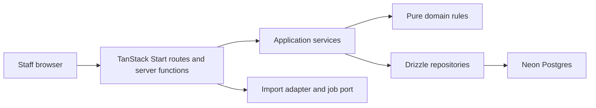

# Architecture overview

## Dependency boundaries

`src/domain` is deterministic TypeScript and has no framework/database imports.
`src/application` coordinates domain rules and depends on interfaces in
`src/application/ports`. `src/db` implements those interfaces. `src/server`
adapts requests to authorized application services. `src/features` contains
the UI and communicates through typed server functions only.

## Deployment

Vercel hosts the TanStack Start/Nitro application. Neon supplies Postgres.
Pure grouping rules remain deterministic. Import reconciliation and application
run through durable Workflow entry points and server steps.

Imports now use the installed Workflow Vite integration and explicit server
steps for reconciliation and authorized application. Deployed source files go
from the browser to private Blob with short-lived per-file upload tokens, then
through server-side validation into a batch manifest. Durable arguments contain
identifiers only. The Apply action records authorization before starting the
application workflow; its step rechecks current organization membership.
Local development can use private filesystem storage.

Lesson sessions combine local hours with a seasonal cohort (`season`,
`session-1`, or `session-2`), optional dates, and no-lesson dates. Numbered
cohorts remain distinct before dates are known. Publication requires their
dates and materializes only actual lesson days. Editing session settings
returns submitted/approved drafts for review; published session settings are
locked. Configuration and publication serialize on the organization so they
cannot race past those protections.
